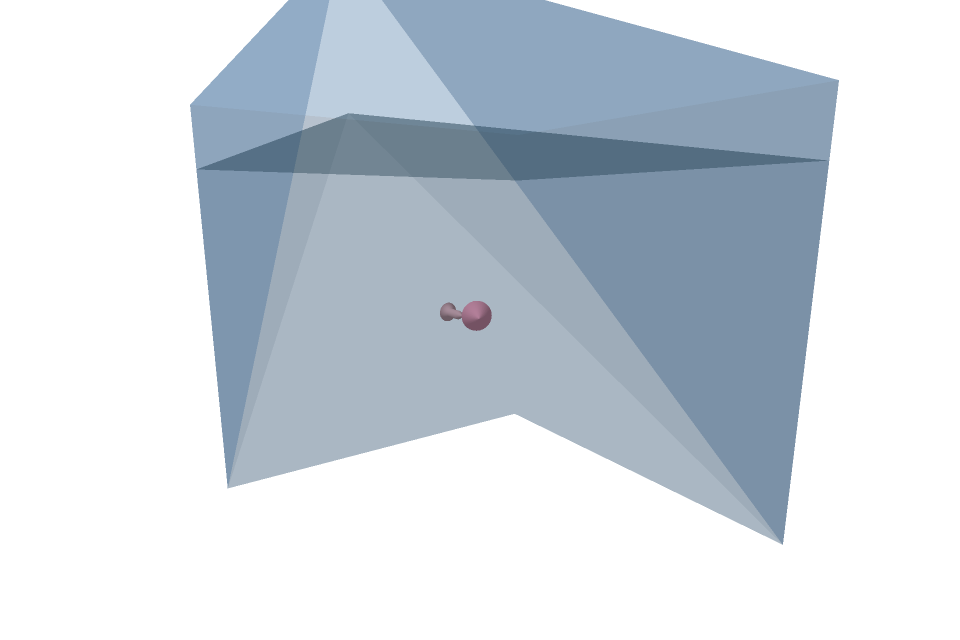

# Software Aquarium

Учебный проект Арсения Батуева по компьютерной графике: трёхмерный аквариум с программным рендерингом на CPU. C++17, Windows API, объектная модель симуляции и собственная растеризация треугольников.



## Возможности

- Процедурная геометрия рыб, перспективная проекция, освещение и Z-буфер.
- Прозрачные поверхности воды и стекла, суперсэмплинг SSAA.
- Движение, приближённые сферические столкновения рыб и отражение от стенок.
- Управление камерой и настройками симуляции, встроенные сценарии измерения времени кадра.

GUI работает в Windows. Вычислительное ядро и его проверки собираются также в Linux. Это учебная симуляция: столкновения используют ограничивающие сферы, геометрическое отсечение упрощено.

## Сборка и запуск

Нужны CMake 3.20+ и компилятор C++17. Для Windows подходят Visual Studio C++ Build Tools или MinGW-w64.

```powershell
cmake -S . -B build
cmake --build build --config Release
ctest --test-dir build -C Release --output-on-failure
```

У Visual Studio приложение находится в `build/Release/aquarium.exe`, у Ninja/MinGW - в `build/aquarium.exe`. Управление: левая кнопка мыши вращает камеру, колесо меняет дистанцию; параметры рыб и запуск симуляции доступны в боковой панели.

Для MinGW и Ninja можно указать компилятор явно:

```powershell
cmake -S . -B build -G Ninja -DCMAKE_CXX_COMPILER=g++ -DCMAKE_BUILD_TYPE=Release
cmake --build build
```

`aquarium_snapshot` экспортирует кадр сцены в BMP без открытия окна. Например: `build/aquarium_snapshot.exe preview.bmp`.

## Проверки и подготовка портфолио

Проверяются перспективная интерполяция цвета, разрешение SSAA, отражение от стенки и сохранение импульса/энергии при упругом столкновении. При подготовке исправлено соответствие барицентрических весов вершинам и очищение сборки без удаления исходных заголовков; добавлены CMake и экспорт демонстрационного кадра. Базовая работа остаётся курсовым проектом.

Бинарные файлы и временные результаты сборки исключены из истории Git. Картинка выше получена из действующего рендерера, а не нарисована отдельно.
